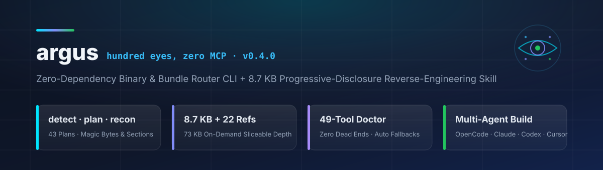

<div align="center">



<br/>

**أداة سطر أوامر صفرية الاعتماديات (`argus`) + مهارة بحجم `8.7 KB` توجّه وكلاء البرمجة (`OpenCode` و`Claude Code` و`Codex` و`Cursor`) إلى أسرع أمر محلي لتحليل أي ملف مُجمَّع أو مبني — تطبيقات `Electron`، الحزم المصغّرة (`Minified JS`)، ثنائيات `Mach-O` و`ELF` و`PE/.NET` و`Go` و`Rust` و`JVM` و`Android APK` و`iOS IPA` و`Unity IL2CPP` و`Flutter` و`Hermes` و`WASM` وقواعد `SQLite` وملفات `pcap` والـ `Firmware` — مع 22 مرجعاً عميقاً (`73 KB`) تُسحب عند الطلب فقط.**

[](https://github.com/abduallahJamal/argus/actions/workflows/ci.yml)
[](package.json)
[](#لماذا-أداة-argus)
[](#الكشف-التدريجي-للمعرفة-progressive-disclosure)
[](#التثبيت-السريع)
[](docs/AUTHORIZATION.md)
[](LICENSE)

**[🇬🇧 English](README.md)** · **🇪🇬 العربية**

</div>

---

<div align="right" dir="rtl">

لا خادم MCP ثقيل، ولا 200 تعريف أداة يستهلك نافذة السياق، ولا حزمة بحجم 25 ميجابايت — فقط `argus`، والـ `shell`، والأدوات المحلية المثبّتة على جهازك.

</div>

```console
$ argus detect ./Foo.app/Contents/Resources/app.asar
kind:       asar  (Electron asar)
confidence: high
evidence:   Electron asar signature [04 00 00 00 b5 00 00 00 b1 00 00 00] @0
hint:       Electron app: also check app.asar.unpacked/ for .node addons

$ argus plan ./gh
kind: go (Go binary, high)
route: Go: `go version -m` answers version, module, deps and build flags in one call.
[tier 1] Build info  -> toolchain, main path, deps, build flags
   $ go version -m "$T" | head -40
```

---

<div align="right" dir="rtl">

## لماذا أداة `argus`؟

استبدال خادم أدوات ضخم بملف توجيه خفيف فكرة صائبة هندسياً، لكن الملف النصي وحده يفتقر إلى **الآلية التنفيذية** في أربع نقاط جوهرية: لا يستطيع فحص البايتات لمعرفة نوع الهدف بنفسه، ولا يخبر الوكيل بالأدوات الناقصة على الجهاز وبدائلها، ولا يمنع نفسه من التضخّم بمرور الوقت، ولا يملك معياراً قابلاً للتكرار لإثبات نتائجه. صُمِّمت **`argus`** لسد هذه الفجوات الأربع بالكود.

| البُعد الهندسي | ملف `SKILL.md` وحده | خادم MCP ضخم | مع منظومة **`argus`** |
| :--- | :--- | :--- | :--- |
| **ما يُثبَّت على الجهاز** | ملف Markdown ثابت | حزمة npm + خادم خلفي مستمر | **أداة CLI بدون أي اعتماديات + مهارة بحجم `8.7 KB`** |
| **تحديد نوع الملف (Routing)** | تخمين النموذج من اسم الملف | أسماء الأدوات فقط | **تواقيع البايتات (`Magic Bytes`) + بنية الحاوية + جداول الأقسام وعلامات البناء** |
| **العمق المعرفي** | تحميل كل شيء أو لا شيء | حقن جميع المخططات دفعةً واحدة | **22 مرجعاً متخصّصاً تُسحب بالقطعة (`argus ref electron ipc`)** |
| **غياب أداة على النظام** | يتوقف الوكيل أو يرتجل | يفشل استدعاء الخادم | **`argus doctor` يطبع البديل الفوري، و`recon` يحوّل `rg` إلى `grep` تلقائياً** |
| **تعدد أنظمة التشغيل** | مكتوب لنظام واحد غالباً | مرتبط بنظام واحد غالباً | **بدائل مدمجة لكل خطوة عبر `macOS` و`Linux` و`Windows`** |
| **انضباط الحجم والسياق** | يتضخّم بلا سقف | يتضخّم بلا سقف | **محكوم آلياً عبر `argus check` في CI (`9 KB` للمهارة و`14 KB` لكل مرجع)** |
| **الطرق المسدودة** | يخمّن الوكيل أوامر بديلة | رسائل خطأ صماء | **يفشل البناء في CI إذا خلت أي خطوة في 43 خطة من `fallback`** |
| **القياس والبنشمارك** | فقرة دعائية غير قابلة للفحص | فقرة دعائية غير قابلة للفحص | **أوزان دقيقة، إجابات محفوظة، إعادة تصحيح آلي، فترات ثقة `Bootstrap CI`، ووضع `--dry`** |

---

## التثبيت السريع

</div>

```sh
git clone https://github.com/abduallahJamal/argus.git && cd argus
npm link                                  # يضيف الأمر argus إلى PATH بدون أي اعتماديات خارجية
argus build                               # يولّد حزم dist/ لجميع وكلاء البرمجة

# تثبيت المهارة والمراجع للوكيل المفضّل لديك:
argus install --agent opencode            # ~/.config/opencode/skills/argus
argus install --agent claude-code         # ~/.claude/skills/argus
argus install --agent codex               # ~/.agents/skills/argus
argus install --agent all                 # OpenCode + Claude Code + Codex + AGENTS.md + Cursor + Gemini + Copilot
```

<div align="right" dir="rtl">

أو عبر النسخ اليدوي المباشر:

</div>

```sh
# OpenCode
mkdir -p ~/.config/opencode/skills && cp -R skill ~/.config/opencode/skills/argus

# Claude Code
mkdir -p ~/.claude/skills && cp -R skill ~/.claude/skills/argus

# Codex CLI
mkdir -p ~/.agents/skills && cp -R skill ~/.agents/skills/argus
```

---

<div align="right" dir="rtl">

## مرجع الأوامر الأساسية

| الأمر | الوظيفة التفصيلية |
| :--- | :--- |
| `argus detect T` | كشف نوع الملف من البايتات الأولى وبنية الحاوية وعلامات البناء مع الدليل ودرجة الثقة (`--json`) |
| `argus plan T` | توليد خطة أوامر مرتّبة بمستويات (`tiers`) وميزانيات مخرجات وبدائل لكل نظام و`fallback` لكل خطوة (`--shell`, `--tier 2`) |
| `argus recon T` | تنفيذ جرد المستوى الأول في استدعاء واحد للخطوات المتوفرة أدواتها فقط بحصة مخرجات عادلة وحفظ التقرير في `recon.json` |
| `argus doctor` | فحص مصفوفة تضم 49 أداة هندسة عكسية محلية، وعرض الإصدارات وأوامر التثبيت **والبديل العملي** لكل أداة غائبة |
| `argus refs` / `argus ref X [كلمة]` | استعراض المكتبة المرجعية (22 موضوعاً)، أو طباعة مرجع محدد، أو استخراج الأسطر المطابقة لكلمة مفتاحية فقط |
| `argus build` | بناء حزم المهارة من مصدر واحد إلى `OpenCode` و`Claude Code` و`Codex` و`AGENTS.md` و`Cursor` و`GEMINI.md` و`Copilot` |
| `argus install --agent …` | نسخ الحزمة المبنية ومراجعها إلى المسار القياسي للوكيل المستهدف |
| `argus check [--fixtures]` | التحقق الصارم من سقف الحجم، وسلامة المراجع والروابط، وتوفّر `fallback` في كل الخطط الـ 43، ودقة توجيه 24 عيّنة |
| `argus report R.jsonl` | حساب الوسيط و`IQR` وفترة الثقة `Bootstrap CI` والدقة الموزونة وتوليد تقرير Markdown **ولوحة HTML تفاعلية مستقلة** |
| `argus grade R.jsonl` | إعادة تصحيح الإجابات المحفوظة بمطابقة متسامحة مع الفواصل وأوزان محددة ومعيار منفصل لجودة الاستشهاد بالدليل |
| `argus verify F` | حساب بصمة `SHA-256` للملفات لتثبيت نزاهة عيّنات الاختبار |

---

## كيف يعمل التوجيه الذكي (`Routing`) فعلياً؟

لا يعتمد `argus` على امتداد الملف السطحي؛ بل يقرأ الترويسة الثنائية (`Magic Bytes`)، ثم يفحص بنية الحاوية الداخلية، ثم يقرأ أقسام بيانات البناء مباشرةً:

</div>

```text
zip    → AndroidManifest.xml + classes.dex?                     → apk
       → Payload/*.app? (+ Frameworks/Flutter.framework?)       → ipa / ipa-flutter
       → META-INF/MANIFEST.MF or *.class?                       → jar
elf    → .go.buildinfo section?                                 → go
       → .dep-v0 section / /rustc/<sha>?                        → rust
       → f5 f5 dc dc (Dart AOT magic)?                          → flutter
macho  → .node extension or NODE_MODULE?                        → native addon
pe     → BSJB / mscoree.dll / System.Private.CoreLib?           → dotnet (or AOT: native)
any    → af 1b b1 fa?                                           → Unity global-metadata
       → c6 1f bc 03?                                           → Hermes bytecode
       → high entropy, no magic, UPX!/Themida?                  → packed (report, don't guess)
```

<div align="right" dir="rtl">

الملفات الثنائية الضخمة لا تُمسح عشوائياً: تقرأ دالة `metadataRegions()` جدول أقسام `ELF` (أو أوامر `LC_SEGMENT_64` في `Mach-O`) وتستهدف فقط الأقسام التي تحمل بصمات المُصرِّف والبناء. وبذلك يُصنَّف ملف `Go` بحجم `55 MB` في أجزاء من الثانية، وإذا لم يتطابق أي توقيع معروف تُرجع الأداة `binary-unknown` مع بايتات الترويسة بوضوح — لأن **`unknown` موثّقة خيرٌ من تخمين واثق وخاطئ**.

---

## الكشف التدريجي للمعرفة (`Progressive Disclosure`)

يبلغ حجم المهارة الأساسية (`skill/SKILL.md`) **`8.7 KB` فقط** (بسقف صارم قدره `9 KB` مفروض في CI): تضم قواعد التشغيل الآمن، وجدول التوجيه السريع، وأربع كتل أوامر فورية، وصيغة الإجابة الموثّقة بالدليل (`seen` / `inferred` / `unknown`). أما التفاصيل العميقة فتسكن في **22 مرجعاً متخصّصاً** بمتوسط `3.3 KB` للمرجع الواحد:

</div>

```console
$ argus ref electron ipc     # يطبع ~40 سطراً مركّزاً بدلاً من تحميل 4.5 KB كاملة
```

<div align="right" dir="rtl">

الوكيل يقرر **متى** يحتاج إلى العمق، والأداة تقرر **كم** تطبع من السطور — بدون إهدار التوكنز أو تلويث السياق.

**المواضيع المرجعية الـ 22:** `electron` · `js-bundles` · `react-native` · `node-addons` · `native-macho` · `native-elf` · `native-pe` · `disassembly` · `go` · `rust` · `dotnet` · `jvm` · `android` · `ios` · `unity-il2cpp` · `flutter-dart` · `firmware` · `formats-db` · `runtime-dynamic` · `crypto-obfuscation` · `wasm` · `evidence`

---

## بلا طرق مسدودة (`Zero Dead Ends`)

تحمل كل خطوة في جميع الخطط الـ 43 بديلاً صريحاً (`fallback`)، ويُفشل `argus check` عملية البناء إذا سقط بديل واحد. وفي وقت التشغيل الفعلي، لا يكتفي `argus recon` بالإبلاغ عن غياب أداة مثل `ripgrep`؛ بل يعيد كتابة الأوامر تلقائياً إلى مكافئات `GNU grep`، ويسجّل التحويل (`rg->grep`) داخل تقرير الأدلة، ويكمل الفحص دون توقف:

</div>

```console
$ argus doctor
argus doctor — platform: linux · core tools: 10/16 · all: 13/49
  --  rg
        install: apt install ripgrep
        instead: `grep -a` / `findstr`; slower but same shape
```

---

<div align="right" dir="rtl">

## منظومة القياس والبنشمارك (`Benchmark Harness`)

مجلد `bench/` هو إطار قياس هندسي قابل للتدقيق وإعادة التشغيل محلياً وليس ادعاءً تسويقياً؛ يضم 24 عيّنة اختبار صناعية (`mkfixtures.mjs`)، وخمس مهام معزولة تماماً، وحفظاً كاملاً للإجابات الخام، وأوزاناً لكل حقيقة، ومفاتيح سلبية (`mustNot`) تمنع الهلوسة، بالإضافة إلى وضع `--dry` لفحص خط الأنابيب كاملاً بدون نموذج أو مفتاح API:

</div>

```sh
node bench/mkfixtures.mjs                 # توليد 24 عيّنة صناعية لجميع الصيغ بدون اتصال بالشبكة
node bench/setup.mjs                      # تجهيز مجلدات المهام المعزولة + ترجمة هدف C الاختباري
node bench/run.mjs --dry --reps 3         # اختبار ذاتي كامل لمنظومة القياس والتقارير
argus report bench/results/run.jsonl --html bench/dashboard.html
argus grade  bench/results/run.jsonl
```

<div align="right" dir="rtl">

ملاحظة شفافية: ملفا `bench/SELF_TEST.md` و`bench/dashboard.html` المرفقان في المستودع مُولَّدان عمداً من بيانات `--dry` لإثبات سلامة خط التوليد والتحقق منه في CI — **لا ينشر هذا المستودع أرقام نماذج مسبقة الصنع**.

---

## هيكل المستودع

| المسار | الدور الهندسي |
| :--- | :--- |
| `bin/argus.mjs` | واجهة سطر الأوامر الموحّدة بدون أي اعتماديات خارجية (`Node >= 18 ESM`) |
| `src/detect.mjs` | فحص التواقيع الثنائية وبنية الحاويات وجداول أقسام `ELF` و`Mach-O` وعلامات البناء |
| `src/plan.mjs` | 43 خطة تحليل ثابت مرتّبة بمستويات وميزانيات مخرجات وبدائل أنظمة و`fallbacks` |
| `src/tools.mjs` | سجل يضم 49 أداة هندسة عكسية محلية مع محوّل `rg` إلى `grep` التلقائي |
| `src/doctor.mjs` | فاحص قدرات الجهاز واقتراح البدائل الفورية عند غياب أي أداة |
| `src/recon.mjs` | منفّذ الجرد المحدود بميزانية بايتات وحفظ تقارير الأدلة بصيغة `JSON` |
| `src/refs.mjs` | محرّك المكتبة المرجعية والبحث المقطعي بالكلمات المفتاحية |
| `src/build.mjs` | بناء حزم المهارة لـ `OpenCode` و`Claude Code` و`Codex` و`AGENTS.md` و`Cursor` و`Gemini` و`Copilot` |
| `src/check.mjs` | مدقق المستودع الصارم (ميزانيات الحجم، سلامة الروابط، الخطط، والعيّنات الـ 24) |
| `src/report.mjs` | التحليل الإحصائي (`Median` / `IQR` / `Bootstrap CI`) وتوليد تقارير `Markdown` ولوحة `HTML` |
| `src/grade.mjs` | مُصحّح الإجابات الموزون والمتسامح مع الفواصل ومعيار جودة الاستشهاد بالأدلة |
| `skill/SKILL.md` | المهارة النواة بحجم `8.7 KB` (محكومة بسقف `9 KB` في `CI`) |
| `skill/references/` | 22 مرجعاً عميقاً في الهندسة العكسية بإجمالي `73 KB` (بسقف `14 KB` لكل مرجع) |
| `bench/` | مولّد العيّنات، المهام، هدف `C` المصدري، ولوحة الفحص الذاتي |
| `test/` | حزمة الاختبارات الآلية الشاملة (`27` اختباراً عبر `node:test`) |

---

## نطاق الاستخدام المصرّح به (`Authorization`)

صُمِّمت أداة `argus` حصرياً للتحليل المشروع: البرمجيات والبناءات التي تملكها، أو الأنظمة التي لديك تصريح كتابي بفحصها (مراجعة أمنية، نطاق `Bug Bounty`، عقود تدقيق)، أو الحالات المسموح بها قانوناً كالتوافقية البينية والبحث الأمني الدفاعي. الأداة **لا تنفّذ** الملفات المستهدفة إطلاقاً، وليست مخصّصة لتجاوز أنظمة الترخيص أو `DRM` أو مكافحة الغش، ولا تعيد توزيع شيفرات طرف ثالث مستخرجة. راجع التفاصيل الكاملة في [docs/AUTHORIZATION.md](docs/AUTHORIZATION.md).

---

## المساهمة والاعتمادات

المساهمات مرحّب بها — خصوصاً خطط الصيغ الجديدة في `src/plan.mjs`، والمراجع المركّزة في `skill/references/`، وعيّنات الاختبار في `bench/mkfixtures.mjs`. راجع [CONTRIBUTING.md](CONTRIBUTING.md) قبل فتح طلب دمج (`Pull Request`).

نقاط المقارنة المرجعية في التصميم: مشروع [REA](https://github.com/morluto/rea) (خادم MCP موسّع للهندسة العكسية) وتجربة [leanrea](https://github.com/aicodeking/leanrea) (التي أظهرت أن ملف مهارة بحجم 8 KB يغني عن طبقة MCP). تبني **`argus`** الآليات الهندسية الكاملة حول تلك الفكرة: الكشف الثنائي الدقيق، وفحص قدرات الجهاز، والبدائل العابرة للأنظمة، وضبط الحجم في CI، وتوليد الحزم لجميع وكلاء البرمجة، ومنظومة القياس القابلة للتكرار. (غير مرتبط بأي من المشروعين).

---

## الرخصة

مُتاح تحت رخصة [MIT License](LICENSE).

</div>
